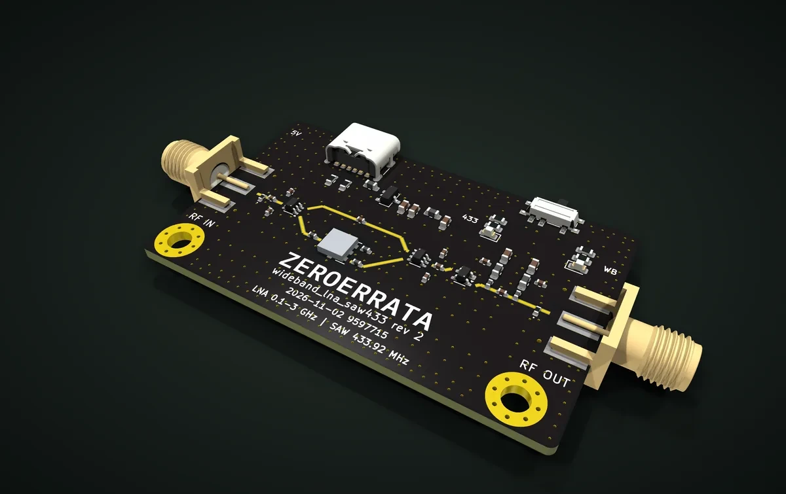
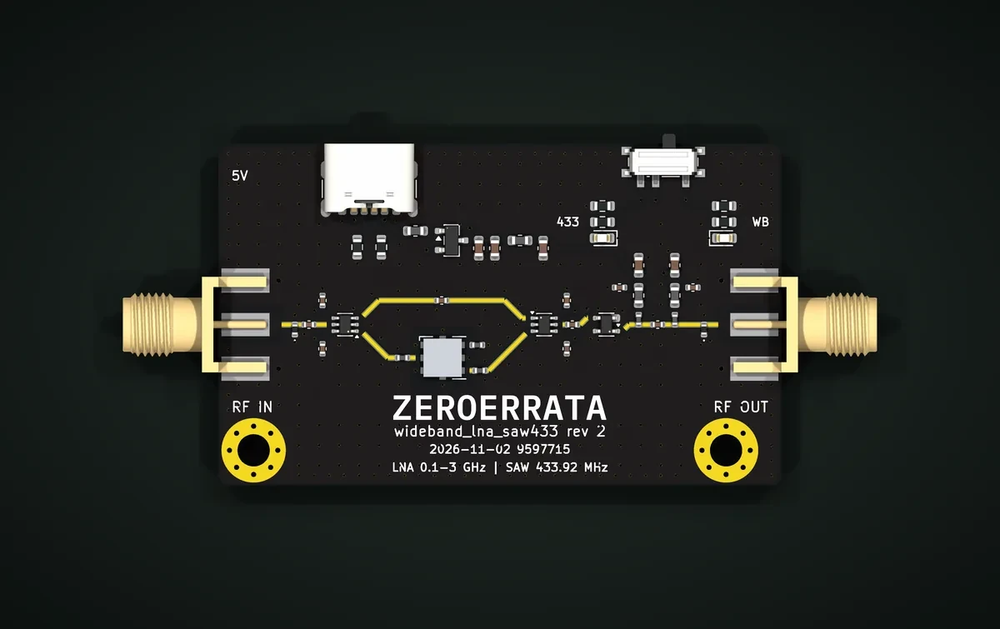
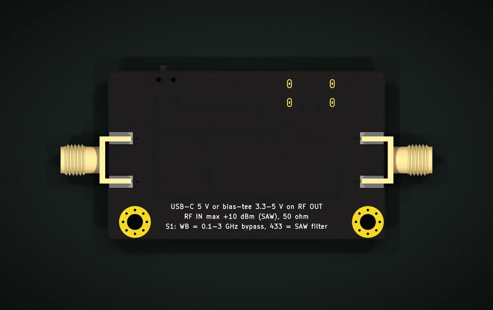
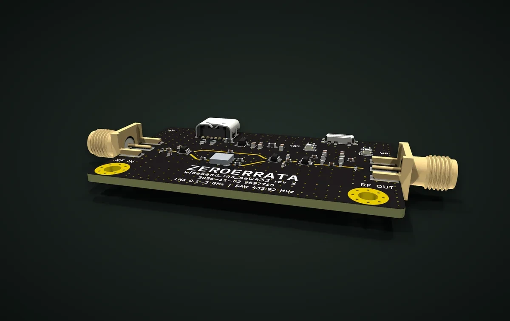

  <a href="https://zeroerrata.eu"><picture>
    <source media="(prefers-color-scheme: dark)" srcset="images/zeroerrata-logo-dark.png">
    
  </picture></a>

<h1 align="center">Wideband LNA 0.1-3 GHz with a 433 MHz SAW filter</h1>

<b>Low-noise amplifier for SDR receivers: SMA in, SMA out, 0.1-3 GHz, with a switchable 433.92 MHz SAW filter.</b>

  
  
  
  

KiCad 10 render

## About

A small RF front end for software-defined radio receivers. A slide switch selects either the wideband path (0.1-3 GHz) or a 433.92 MHz SAW filter in front of the low-noise amplifier, so the same board serves as a general-purpose LNA and as a narrowband ISM-band preamplifier. It is powered from USB-C (5 V, power only) or through the RF output coax from the receiver's bias-tee (3.3-5 V); the two supplies are OR-ed by a Schottky pair, so it works on the bench and at the antenna mast.

The RF lines are 50-ohm grounded coplanar waveguide without solder mask on a 4-layer board with ENIG finish, fenced by ground vias, with tapered launches into edge-mount SMA connectors.

## Features

- Qorvo SPF5043Z LNA: NF 0.6-0.84 dB up to 2.2 GHz, gain about 23.5 dB at 0.1 GHz falling to about 10 dB at 3 GHz, OIP3 33-35 dBm
- Switchable RF360 B3790 SAW filter, 433.92 MHz (about 0.4 MHz at -3 dB, 55-65 dB stop band), with its matching network
- Two Skyworks AS179-92LF SPDT switches in series around the filter: about 50 dB leakage suppression, a LED for each mode
- Powered by USB-C 5 V or by bias-tee over the RF OUT coax (3.3-5 V)
- 50-ohm grounded coplanar waveguide (0.345 mm track, 0.3 mm gap, no solder mask), via fences, edge-launch SMA
- Hand-solderable: SOT-343 / SOT-363, 0402 on the RF path, 0603 elsewhere (the SAW needs hot air or a hot plate)

## Specifications

| | |
|---|---|
| Board | 56.0 x 34.0 mm, 4 copper layers, 1.6 mm |
| Finish | ENIG |
| Parts | 46 |
| Release | rev 2, 2026-11-20 |
| Frequency | 0.1-3 GHz (wideband) or 433.92 MHz (SAW) |
| RF connectors | 2 x edge-launch SMA, 50 ohm |
| Supply | USB-C 5 V or bias-tee 3.3-5 V on RF OUT |
| Stackup | 4 layers, 1.6 mm, outer copper 1 oz; RF on the top layer over a solid ground plane |

## Renders

| Top | Bottom | Low |
|---|---|---|
|  |  |  |

## Files

| Folder | Contents |
|---|---|
| [`kicad/`](kicad) | KiCad 10 project: schematic, board, design rules, project libraries |
| [`docs/`](docs) | [schematic.pdf](docs/schematic.pdf), [board_layers.pdf](docs/board_layers.pdf), [assembly_top.pdf](docs/assembly_top.pdf) |
| [`fabrication/`](fabrication) | Gerber and drill files (zip), bill of materials, pick-and-place |
| [`images/`](images) | renders and copper layer pictures |
| [`analysis/`](analysis) | simulation and analysis results: retpath, sparam, thermal |

## Verification

- 50-ohm RF lines checked by a field solver: 12 RF nets at 50.0-51.6 ohm
- RF chain cascade (gain, noise figure, match) and Monte Carlo over part tolerances: see analysis/sparam
- Thermal map, return paths of the RF nets and a reflow balance check: see analysis/
- Every result is a prediction from design data; the board has not been measured unless stated.

## How to order

1. Upload `fabrication/gerbers_drill.zip` to your PCB fab; the stackup and finish are in the specifications above.
2. For assembly, use `fabrication/bom_jlcpcb.csv` and `fabrication/cpl_jlcpcb.csv` (JLCPCB format) or the KiCad-format `bom.csv` / `pos.csv`.
3. Check part stock and the footprints against the current data sheets before you order.

## Notes

- The renders show the ZeroErrata house look (black solder mask); the rev 2 fabrication package as released specifies the fab's standard green mask. Choose the mask colour when you order.
- The SAW filter has its pads under the body: solder it with hot air or a hot plate.

## Licence

Released under the [CERN Open Hardware Licence Version 2 - Permissive](LICENSE) (CERN-OHL-P-2.0): use, modify, make and sell it, also commercially. Provided as is, without warranty.

---

  Designed by <a href="https://zeroerrata.eu"><b>ZeroErrata</b></a>: PCB design, verified before it is ordered. 
  <a href="https://zeroerrata.eu">zeroerrata.eu</a> · <a href="mailto:hello@zeroerrata.eu">hello@zeroerrata.eu</a>

